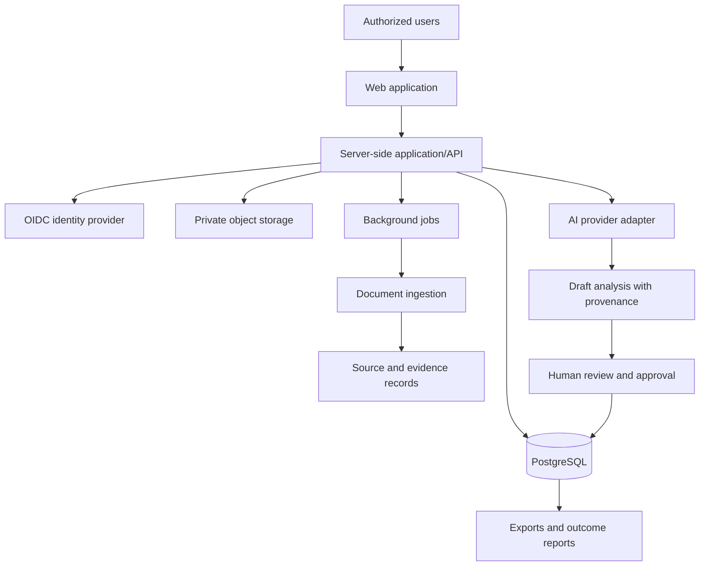

# Atlas Legacy Intelligence

**Decision intelligence for responsible capital stewardship and measurable regeneration.**

Atlas Legacy Intelligence is a proposed product within **Atlas Sanctum**. It is designed to help family offices, foundations, diaspora investors, and other capital stewards organize mandates, research opportunities, assess evidence and risks, document decisions, and monitor project milestones and reported outcomes—with a focus on African enterprises and regeneration opportunities.

> **Project status: Documentation and design baseline.** This repository currently contains specifications and implementation drafts, not a completed or production-ready application. Features described here are proposed capabilities unless explicitly marked as implemented.

## Why this project

Long-term capital decisions often require evidence from fragmented sources, clear governance, coordinated diligence, and credible reporting after a decision is made. Atlas Legacy Intelligence proposes a shared workspace to help teams make these workflows more transparent, traceable, and repeatable.

The product is intended to support better-informed human decisions—not replace fiduciaries, professional advisers, project operators, independent evaluators, or the people and communities affected by an allocation.

## Product principles

- **Evidence before assertion:** preserve source provenance, dates, limitations, and review status.
- **Human accountability:** AI-generated material is a draft; consequential decisions require authorized human review.
- **Transparent evaluation:** make assessment criteria, assumptions, uncertainty, and conflicts of interest visible.
- **Privacy and least privilege:** isolate organizations and restrict access to sensitive records.
- **Regeneration with integrity:** distinguish proposed outcomes, project-reported data, and independently verified results.
- **Pragmatic architecture:** build only what validates a real user problem and creates measurable value.

## Proposed MVP capabilities

1. **Organization and membership** — organization-scoped workspaces and role-based access.
2. **Legacy and allocation mandates** — record goals, constraints, priorities, exclusions, and review cycles.
3. **Opportunity registry** — organize enterprises and projects with status, eligibility, ownership, and funding needs.
4. **Evidence library** — manage sources, documents, provenance, freshness, permissions, and information gaps.
5. **Structured assessments** — compare opportunities using documented criteria, risks, and confidence levels.
6. **Decision records** — preserve rationale, approvals, assumptions, and change history.
7. **Milestones and outcomes** — track implementation milestones, indicators, baselines, targets, and reported results.
8. **Audit trail and exports** — support review, accountability, and institution-ready reporting.

AI assistance may be introduced behind an explicit provider interface, with retrieval limited to authorized information, source references where available, clear uncertainty, and human-review controls. It must not silently approve assessments or decisions.

## Architecture at a glance



### Proposed technology baseline

The exact implementation stack and versions are to be selected and pinned during implementation. The current design baseline proposes:

- **Web:** TypeScript, React, Next.js App Router, Tailwind CSS, accessible UI primitives.
- **API:** server-side application services, versioned REST endpoints, OpenAPI contract.
- **Data:** PostgreSQL and private object storage for files.
- **Identity:** OIDC-compatible provider, MFA for privileged accounts, organization-scoped authorization.
- **Asynchronous work:** background jobs for long-running document and reporting tasks.
- **AI:** provider adapter, authorized retrieval, structured draft outputs, and review states.
- **Operations:** managed hosting and database, migrations, centralized logs, monitoring, backups, and staged deployments.

This is a proposed architecture, not a statement that these services are deployed or integrations are operational.

## Repository map

```text
.
├── README.md
├── .env.example
├── docker-compose.yml
├── DOCUMENTATION_INDEX.json
├── adr/
│   └── 0001-proposed-mvp-stack.md
├── api/
│   └── openapi.yaml
├── database/
│   └── schema.sql
├── design/
│   └── rubric-template.md
├── docs/
│   ├── 01-product-charter.md
│   ├── 02-product-requirements.md
│   ├── 03-system-architecture.md
│   ├── 04-domain-and-data-model.md
│   ├── 05-api-and-integration-guide.md
│   ├── 06-ai-evidence-governance.md
│   ├── 07-security-privacy-and-compliance.md
│   ├── 08-ux-workflows-and-accessibility.md
│   ├── 09-testing-and-quality-plan.md
│   ├── 10-devops-and-deployment.md
│   ├── 11-operations-and-incident-response.md
│   ├── 12-roadmap-and-delivery-plan.md
│   ├── 13-risk-register.md
│   └── 14-glossary-and-decisions.md
└── operations/
    └── production-readiness-checklist.md
```

### Where to start

| If you need to… | Read |
|---|---|
| Understand the vision, users, goals, and non-goals | [`docs/01-product-charter.md`](docs/01-product-charter.md) |
| Build the MVP backlog and acceptance tests | [`docs/02-product-requirements.md`](docs/02-product-requirements.md) |
| Understand the proposed components and data flows | [`docs/03-system-architecture.md`](docs/03-system-architecture.md) |
| Review domain entities and data governance | [`docs/04-domain-and-data-model.md`](docs/04-domain-and-data-model.md) and [`database/schema.sql`](database/schema.sql) |
| Review endpoints and API conventions | [`api/openapi.yaml`](api/openapi.yaml) and [`docs/05-api-and-integration-guide.md`](docs/05-api-and-integration-guide.md) |
| Understand AI boundaries and evidence handling | [`docs/06-ai-evidence-governance.md`](docs/06-ai-evidence-governance.md) |
| Review security, privacy, and legal gates | [`docs/07-security-privacy-and-compliance.md`](docs/07-security-privacy-and-compliance.md) |
| Prepare deployments and operations | [`docs/10-devops-and-deployment.md`](docs/10-devops-and-deployment.md), [`docs/11-operations-and-incident-response.md`](docs/11-operations-and-incident-response.md), and [`operations/production-readiness-checklist.md`](operations/production-readiness-checklist.md) |
| Understand milestones and risks | [`docs/12-roadmap-and-delivery-plan.md`](docs/12-roadmap-and-delivery-plan.md) and [`docs/13-risk-register.md`](docs/13-risk-register.md) |

## Getting started with the documentation

This repository is currently documentation-first. There is no application command such as `npm run dev` until the application scaffold is implemented.

1. Read the product charter and requirements.
2. Review the open questions and proposed architecture decisions.
3. Validate the MVP use case with prospective users before committing to a full build.
4. Review `database/schema.sql`, `api/openapi.yaml`, `.env.example`, and `docker-compose.yml` as drafts—not production-ready assets.
5. Create tracked implementation issues with owners, acceptance criteria, and tests.
6. Complete privacy, security, legal, and operational reviews before using confidential or live customer data.

A local PostgreSQL service may be defined by `docker-compose.yml`; inspect the file and environment configuration before running it. Do not put real credentials in the repository.

## Security and responsible use

- Never commit credentials, API keys, private client data, or unredacted reports.
- Use synthetic or properly anonymized data during development and demonstrations.
- Enforce organization-level authorization in the server-side data access layer; do not rely solely on hiding UI elements.
- Treat uploaded documents and retrieved text as untrusted input, especially when used with AI systems.
- Require human approval for consequential assessments and decisions.
- Record whether outcomes are self-reported, independently reviewed, or verified under a defined methodology.
- Conduct a threat model and relevant legal and regulatory review before production use.

Atlas Legacy Intelligence is intended as a decision-support and reporting system. It is not, by itself, a bank, custodian, investment manager, broker, legal adviser, tax adviser, or independent certification body. Do not use it to custody or move client funds, execute trades, issue tokens, or provide regulated services without qualified legal review and any required authorizations.

For operational response procedures, see [`docs/11-operations-and-incident-response.md`](docs/11-operations-and-incident-response.md).

## Roadmap: proposed sequence

- **Phase 0 — Discovery:** validate customer problem, first user segment, workflows, and willingness to pay.
- **Phase 1 — Secure core:** identity, organizations, membership, mandates, opportunity registry, evidence records, and audit events.
- **Phase 2 — Decision workflows:** assessments, decision logs, milestones, outcome indicators, and exports.
- **Phase 3 — Controlled AI assistance:** authorized retrieval, source-linked drafts, evaluation tests, and human review.
- **Phase 4 — Pilot readiness:** security and privacy review, backups and recovery tests, monitoring, runbooks, and pilot acceptance.

Expansion should depend on validated demand, delivery quality, and readiness gates—not on feature count.

## Project status and contribution

**Current status:** specification and design baseline. No production deployment, paying customers, live integrations, verified impact claims, or completed security certification are asserted by this repository.

For an initial contribution:

1. Identify an ambiguity, unsupported assumption, technical risk, or requirement gap.
2. Propose a focused change with the rationale and affected documents.
3. Include acceptance criteria, migration implications, security considerations, and tests where relevant.
4. Update the documentation index if files are added or renamed.

Before opening this repository publicly, choose and add an appropriate `LICENSE` file and define contribution and security-reporting processes. Until a license is added, do not assume others have permission to reuse the project code or documentation.

## Mission

Atlas Sanctum aims to connect data, governance, capital, and action to enable measurable regeneration. Atlas Legacy Intelligence is one proposed entry point: helping capital stewards make more informed, accountable decisions while respecting human dignity, local agency, and the limits of available evidence.

**Build in stages. Verify before claiming. Let evidence inform decisions, ethics constrain power, and measurable outcomes guide learning.**
